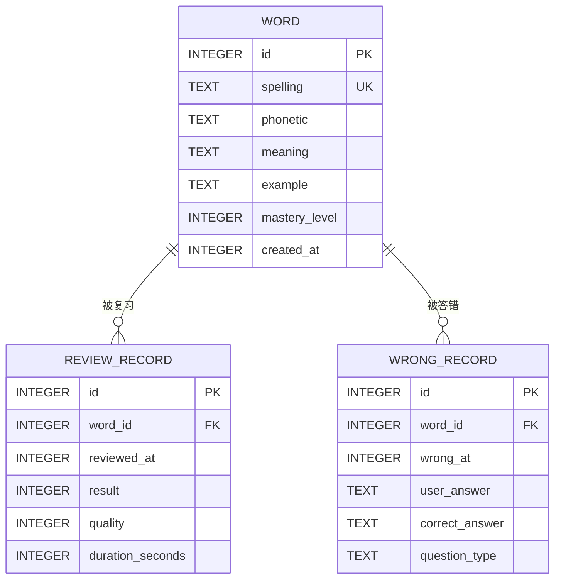

# 里程碑 2：数据模型设计

> 范围：只设计数据层（Room Entity、DAO、Database），不包含 UI 和复习算法。  
> 技术：Room 2.8.5 + KSP2，数据库名 `word_memory.db`，当前版本 `1`。

## 1. ER 图（文字版）



等价的纯文本关系：

```text
Word (1) ──────< (N) ReviewRecord
Word (1) ──────< (N) WrongRecord
```

- 一个单词可以有多条复习记录；
- 一个单词可以有多条错题记录；
- 删除单词时，关联的复习记录和错题记录级联删除；
- 复习记录和错题记录都不能脱离单词单独存在。

## 2. 表结构

### 2.1 `words`：单词表

| 字段 | 类型 | 约束 | 说明 |
|---|---|---|---|
| `id` | INTEGER | 主键，自增 | 单词 ID |
| `spelling` | TEXT | 非空，唯一索引（NOCASE） | 单词拼写，大小写不敏感判重 |
| `phonetic` | TEXT | 非空，默认空串 | 音标 |
| `meaning` | TEXT | 非空 | 中文释义 |
| `example` | TEXT | 可空 | 例句 |
| `mastery_level` | INTEGER | 非空，默认 0 | 0 未学，1 学习中，2 已掌握 |
| `created_at` | INTEGER | 非空，普通索引 | 创建时间，Unix 毫秒 |

索引：

- `index_words_spelling`：唯一索引，避免重复单词；
- `index_words_created_at`：按创建时间排序。

### 2.2 `review_records`：复习记录表

| 字段 | 类型 | 约束 | 说明 |
|---|---|---|---|
| `id` | INTEGER | 主键，自增 | 复习记录 ID |
| `word_id` | INTEGER | 外键 → `words.id`，非空，ON DELETE CASCADE | 对应单词 |
| `reviewed_at` | INTEGER | 非空，普通索引 | 复习时间，Unix 毫秒 |
| `result` | INTEGER | 非空 | 是否答对：0 错，1 对 |
| `quality` | INTEGER | 非空 | 回答质量 0–5，供后续算法使用 |
| `duration_seconds` | INTEGER | 非空，默认 0 | 本次耗时（秒） |

索引：

- `index_review_records_word_id`：按单词查复习历史；
- `index_review_records_reviewed_at`：按时间倒序查询、做趋势统计。

### 2.3 `wrong_records`：错题表

| 字段 | 类型 | 约束 | 说明 |
|---|---|---|---|
| `id` | INTEGER | 主键，自增 | 错题记录 ID |
| `word_id` | INTEGER | 外键 → `words.id`，非空，ON DELETE CASCADE | 对应单词 |
| `wrong_at` | INTEGER | 非空，普通索引 | 答错时间，Unix 毫秒 |
| `user_answer` | TEXT | 可空 | 用户答案 |
| `correct_answer` | TEXT | 可空 | 正确答案 |
| `question_type` | TEXT | 可空 | `CHOICE` 选择 / `SPELLING` 拼写 |

索引：

- `index_wrong_records_word_id`：按单词查错题历史；
- `index_wrong_records_wrong_at`：按时间倒序查询。

## 3. 设计说明

1. **只保留三张表**：词书、学习计划等后续需要时再扩展，当前先把单词、复习、错题的主链路建好。
2. **外键 + 级联删除**：单词被删除后，复习记录和错题记录自动清理，避免孤儿数据。
3. **时间统一用 Unix 毫秒**：方便排序、按日聚合和伴生端统计。
4. **掌握程度放在 Word 上**：看板可以直接统计三档分布；每次复习的细节仍保留在 ReviewRecord 中。
5. **错题按事件记录**：每次答错一条记录，后续既可以统计错误次数，也可以做难词榜。
6. **Flow 查询**：列表类查询返回 `Flow`，Repository 可直接暴露给 ViewModel；写入方法使用 `suspend`。
7. **不写算法**：`quality`、`result` 只存结果，SM-2/间隔计算留到后续里程碑。

## 4. 对应代码

| 内容 | 路径 |
|---|---|
| Word 实体 | `app/src/main/java/com/example/wordmemory/data/local/entity/Word.kt` |
| ReviewRecord 实体 | `app/src/main/java/com/example/wordmemory/data/local/entity/ReviewRecord.kt` |
| WrongRecord 实体 | `app/src/main/java/com/example/wordmemory/data/local/entity/WrongRecord.kt` |
| WordDao | `app/src/main/java/com/example/wordmemory/data/local/dao/WordDao.kt` |
| ReviewRecordDao | `app/src/main/java/com/example/wordmemory/data/local/dao/ReviewRecordDao.kt` |
| WrongRecordDao | `app/src/main/java/com/example/wordmemory/data/local/dao/WrongRecordDao.kt` |
| Database | `app/src/main/java/com/example/wordmemory/data/local/AppDatabase.kt` |

Room schema 会导出到 `app/schemas/`，后续数据库升级时保留并提交这些 JSON 文件，用于迁移审查和测试。

## 5. 后续 Repository 约定

```text
ViewModel
   ↓ StateFlow
Repository
   ↓ suspend 写入 / Flow 读取
DAO
   ↓
Room / SQLite
```

- Repository 不直接持有 `RoomDatabase`，只注入三个 DAO；
- 写操作使用 `suspend`，由 ViewModel 的 `viewModelScope` 调用；
- 读操作返回 `Flow`，在 Repository 中可做 `map`/`combine` 组合；
- 后续增加 Room 版本时，使用 `Migration`，不使用破坏性迁移。
