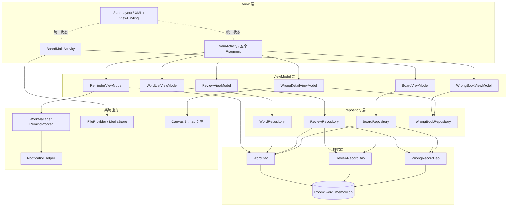
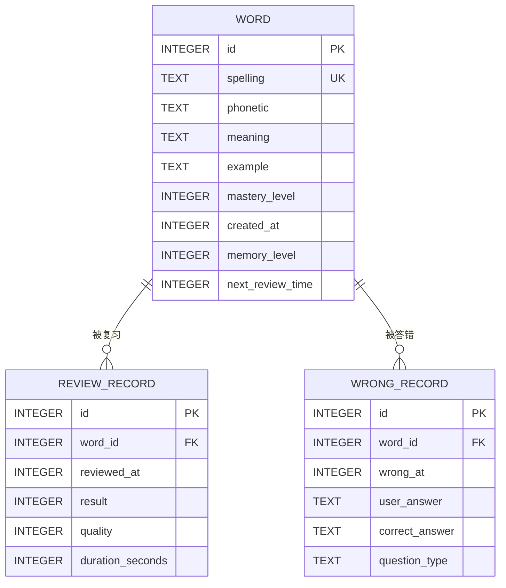

# 课程设计开发文档

**题目：B4 单词记忆 + P2 数据看板**

**技术路线：Kotlin 原生 Android Studio，不使用 Flutter / React Native / uni-app 等跨平台框架**

**文档版本：v1.0　日期：2026-11-28**

---

## 1. 需求分析

### 1.1 项目背景

单词记忆类 App 的核心问题不是“把单词存进去”，而是让用户按照遗忘规律持续复习，并能看到自己的学习过程。传统单词本只解决录入和浏览，复习时机依赖用户自己安排，长期使用容易出现“背了忘、忘了再背”的循环。

本项目把需求拆成两个端：

- **B4 单词记忆（主 App）**：负责词库管理、到期复习、艾宾浩斯升级/重置、错题收集、复习提醒和页面状态管理，是学习数据的唯一写入方。
- **P2 数据看板（伴生模块）**：以独立入口打开，读取主 App 的 Room 数据，展示学习统计、近 7 天复习趋势、记忆等级分布，并支持导出 CSV。看板只读，不修改学习数据。

### 1.2 用户与使用场景

| 角色 | 场景 | 目标 |
|---|---|---|
| 学生用户 | 添加课程单词，按计划复习 | 用较短时间完成每日复习，减少遗忘 |
| 学生用户 | 答错后查看错题本 | 找到薄弱单词，移除已经掌握的错题 |
| 学生用户 | 打开数据看板 | 查看总词数、今日复习量、正确率、等级分布 |
| 学生用户 | 导出复习记录或分享错题卡片 | 保存学习证据，用于复习总结或展示 |
| 课程验收教师 | 启动两个入口、查看数据和异常处理 | 验证功能完整性、算法可解释性和工程规范 |

### 1.3 功能需求

#### 1.3.1 主 App 功能需求

| 编号 | 功能 | 需求说明 | 当前状态 |
|---|---|---|---|
| B4-01 | 词库管理 | 新增、编辑、删除单词；英文单词唯一；列表按创建时间倒序 | 已完成 |
| B4-02 | 单词列表状态 | 加载、空词库、错误重试；下拉刷新 | 已完成 |
| B4-03 | 复习卡片 | 正面显示英文，点击翻转显示音标和释义 | 已完成 |
| B4-04 | 记住/忘记 | 记住升级，忘记重置并写入错题本 | 已完成 |
| B4-05 | 艾宾浩斯算法 | 0–8 级，5 分钟到 30 天间隔，答对升级、答错重置 | 已完成 |
| B4-06 | 复习队列 | 查询 `next_review_time <= 当前时间` 的单词 | 已完成 |
| B4-07 | 复习完成空态 | 队列为空时显示本轮完成提示 | 已完成 |
| B4-08 | 错题本 | 按单词聚合答错次数和最近答错时间 | 已完成 |
| B4-09 | 错题详情 | 展示单词、释义、答错次数、上次答错时间 | 已完成 |
| B4-10 | 移出错题本 | 删除该单词的全部错题记录，不删除单词 | 已完成 |
| B4-11 | 复习提醒 | Android 13+ 通知权限、每日 20:00 WorkManager 提醒 | 已完成 |
| B4-12 | 权限降级 | 通知关闭时首页显示待复习数量与手动开启提示 | 已完成 |
| B4-13 | 错题卡片分享 | Canvas 生成图片卡片，FileProvider + 系统分享 | 已完成 |
| B4-14 | 全局状态 | 加载、空、错误、成功四态统一封装 | 已完成 |
| B4-15 | 学习计划/测验 | 每日目标、选择/拼写测验 | 未纳入当前版本 |
| B4-16 | 数据/设置页 | 数据页和设置页的完整业务 | 当前为空壳 |

#### 1.3.2 伴生看板功能需求

| 编号 | 功能 | 需求说明 | 当前状态 |
|---|---|---|---|
| P2-01 | 独立入口 | `BoardMainActivity` 声明为第二个 Launcher，可单独点击打开 | 已完成 |
| P2-02 | 今日概览 | 总单词数、今日复习、今日正确率、错题总数 | 已完成 |
| P2-03 | 记忆等级分布 | 0–8 级单词数量、条形进度和饼图 | 已完成 |
| P2-04 | 近 7 天趋势 | 每日复习数量柱状图 | 已完成 |
| P2-05 | 图表空态 | 没有复习记录时柱状图显示提示 | 已完成 |
| P2-06 | CSV 导出 | 导出复习记录全部字段到下载目录 | 已完成 |
| P2-07 | 异常与空态 | 数据库读取失败提示、无数据空态 | 已完成 |
| P2-08 | 独立 APK | 作为单独 APK 安装的完整宿主 | 当前为同 APK 第二 Launcher，详见 5.3 |

### 1.4 非功能需求

| 类别 | 要求 | 落地方式 |
|---|---|---|
| 平台 | Kotlin 原生 Android | XML + ViewBinding + Material 3 |
| 最低版本 | Android 7.0（minSdk 24） | 兼容通知、FileProvider、Room |
| 目标版本 | Android 15+（compileSdk/targetSdk 37） | Android 13+ 权限适配 |
| 数据一致性 | 复习结果、复习记录、错题记录要么都成功，要么都回滚 | Room `withTransaction` |
| 线程 | 数据库和文件操作不阻塞主线程 | `Dispatchers.IO` + `viewModelScope` |
| 可靠性 | 数据库/IO 异常进入错误态或 Toast，不崩溃 | Repository `Result` + StateLayout |
| 存储 | CSV 导出不需要存储权限 | Android 10+ MediaStore |
| 可维护性 | 页面状态、Toast、字体、间距统一 | `:core_ui` 共享模块 |
| 可演示性 | 主 App 和看板均可独立点击启动 | 两个 Launcher Activity |

---

## 2. 功能结构

### 2.1 模块拆分

```text
WordMemoryB4
├─ :app                    B4 主 App（com.android.application）
├─ :core_data              共享 Room 数据层（com.android.library）
├─ :core_ui                统一状态 / Toast / 字体 / 间距（com.android.library）
└─ :data_board_module      P2 数据看板（com.android.library，独立 Launcher）
```

依赖关系：

```text
:app
 ├─ :core_data
 ├─ :core_ui
 └─ :data_board_module
        ├─ :core_data
        └─ :core_ui
```

`data_board_module` 作为 Library 被 `:app` 合入同一个 APK；它自己声明 `MAIN`/`LAUNCHER` Activity，所以桌面上会有“单词记忆”和“数据看板”两个入口。两者同 APK、同进程、同 UID，直接共享 `word_memory.db`。

### 2.2 主 App 功能结构

```text
MainActivity
├─ 单词本 WordListFragment
│  ├─ 加载/空/错误/成功 StateLayout
│  ├─ RecyclerView + SwipeRefreshLayout
│  ├─ 新增/编辑弹窗
│  ├─ 删除确认
│  └─ 待复习提醒条（通知权限降级）
├─ 复习 ReviewFragment
│  ├─ 卡片翻转
│  ├─ 记住 / 忘记
│  ├─ 复习完成空态
│  └─ 错误重试
├─ 错题本 WrongBookFragment
│  ├─ 按单词聚合的错题列表
│  └─ 点击进入 WrongDetailFragment
│       ├─ 错题信息
│       ├─ 分享卡片
│       └─ 移出错题本
├─ 数据 HomeStatFragment（空壳）
└─ 设置 SettingFragment（空壳）
```

### 2.3 伴生模块功能结构

```text
BoardMainActivity（独立 Launcher）
├─ 四张统计卡片
│  ├─ 总单词数
│  ├─ 今日复习
│  ├─ 今日正确率
│  └─ 错题总数
├─ 各记忆等级单词数（0–8）
├─ 近 7 天每日复习柱状图
├─ 记忆等级分布饼图
├─ 导出 CSV
└─ StateLayout：加载 / 空 / 错误 / 成功
```

---

## 3. 系统架构图

### 3.1 MVVM 分层



### 3.2 关键设计说明

1. **View 不直接访问 DAO**：Fragment/Activity 只通过 ViewModel 暴露的 `StateFlow`/事件更新界面。
2. **Repository 统一处理线程和异常**：DAO 的 `suspend` 方法放到 `Dispatchers.IO`，返回 `Result`；Flow 使用 `flowOn(IO)`。
3. **Room 是唯一数据源**：主 App 写入，看板只读；没有两份数据库。
4. **StateLayout 统一页面兜底**：成功、加载、空、错误四态由 `:core_ui` 提供。
5. **WorkManager 只负责触发**：查询到期单词和发通知在 `RemindWorker` 中完成，不依赖页面存活。

---

## 4. 数据库 ER 设计说明

### 4.1 ER 图



### 4.2 表设计

#### words

| 字段 | 类型 | 说明 |
|---|---|---|
| id | INTEGER PK | 自增主键 |
| spelling | TEXT | 单词拼写，NOCASE 唯一索引 |
| phonetic | TEXT | 音标 |
| meaning | TEXT | 中文释义 |
| example | TEXT | 例句，可空 |
| mastery_level | INTEGER | 列表展示状态：0 未学、1 学习中、2 已掌握 |
| created_at | INTEGER | 创建时间，Unix 毫秒 |
| memory_level | INTEGER | 艾宾浩斯等级 0–8 |
| next_review_time | INTEGER | 下次复习时间，Unix 毫秒，可空 |

索引：

```sql
UNIQUE INDEX index_words_spelling ON words(spelling);
INDEX index_words_created_at ON words(created_at);
INDEX index_words_next_review_time ON words(next_review_time);
```

#### review_records

| 字段 | 类型 | 说明 |
|---|---|---|
| id | INTEGER PK | 自增主键 |
| word_id | INTEGER FK | 关联 `words.id`，级联删除 |
| reviewed_at | INTEGER | 复习时间 |
| result | INTEGER | 1 答对，0 答错 |
| quality | INTEGER | 本次质量，答对 5，答错 1 |
| duration_seconds | INTEGER | 本次耗时，默认 0 |

索引：

```sql
INDEX index_review_records_word_id ON review_records(word_id);
INDEX index_review_records_reviewed_at ON review_records(reviewed_at);
```

#### wrong_records

| 字段 | 类型 | 说明 |
|---|---|---|
| id | INTEGER PK | 自增主键 |
| word_id | INTEGER FK | 关联 `words.id`，级联删除 |
| wrong_at | INTEGER | 答错时间 |
| user_answer | TEXT | 用户答案，可为空 |
| correct_answer | TEXT | 正确答案 |
| question_type | TEXT | 题型，复习答错写 `REVIEW` |

索引：

```sql
INDEX index_wrong_records_word_id ON wrong_records(word_id);
INDEX index_wrong_records_wrong_at ON wrong_records(wrong_at);
```

### 4.3 关系与约束

- 一个 `Word` 对应多条 `ReviewRecord` 和 `WrongRecord`。
- 删除一个 `Word` 时，关联复习记录和错题记录通过 `CASCADE` 一起删除。
- 同一个单词拼写只允许一条记录（`NOCASE`），避免 `Abandon` 和 `abandon` 重复。
- 错题本按 `word_id` 聚合，答错次数用 `COUNT`，最近时间用 `MAX(wrong_at)`。

### 4.4 版本与迁移

数据库版本从 v1 升级到 v2：

```sql
ALTER TABLE words ADD COLUMN memory_level INTEGER NOT NULL DEFAULT 0;
ALTER TABLE words ADD COLUMN next_review_time INTEGER;
CREATE INDEX index_words_next_review_time ON words(next_review_time);
```

迁移注册在 `AppDatabase.MIGRATION_1_2`，没有使用破坏性迁移。

---

## 5. 核心模块实现说明

### 5.1 艾宾浩斯算法

#### 5.1.1 间隔表

| 等级 | 间隔 | 毫秒 |
|---|---|---|
| 0 | 5 分钟 | 300000 |
| 1 | 30 分钟 | 1800000 |
| 2 | 12 小时 | 43200000 |
| 3 | 1 天 | 86400000 |
| 4 | 2 天 | 172800000 |
| 5 | 4 天 | 345600000 |
| 6 | 7 天 | 604800000 |
| 7 | 15 天 | 1296000000 |
| 8 | 30 天 | 2592000000 |

#### 5.1.2 算法规则

```text
输入：currentLevel (0–8), correct (Boolean), now (Long)
1. safeLevel = currentLevel 夹在 0–8
2. nextLevel = correct ? min(safeLevel + 1, 8) : 0
3. interval = INTERVALS_MS[nextLevel]
4. nextReviewTime = now + interval
输出：nextLevel, interval, nextReviewTime
```

例如：

- 0 级答对：升到 1 级，下一次 30 分钟后；
- 3 级答错：回到 0 级，下一次 5 分钟后；
- 8 级答对：保持 8 级，下一次 30 天后。

#### 5.1.3 核心代码

```kotlin
fun nextLevel(currentLevel: Int, correct: Boolean): Int {
    val safeLevel = currentLevel.coerceIn(0, MAX_LEVEL)
    return if (correct) {
        (safeLevel + 1).coerceAtMost(MAX_LEVEL)
    } else {
        0
    }
}

fun schedule(
    currentLevel: Int,
    correct: Boolean,
    now: Long = System.currentTimeMillis(),
): ReviewSchedule {
    val newLevel = nextLevel(currentLevel, correct)
    val interval = intervalForLevel(newLevel)
    return ReviewSchedule(
        nextLevel = newLevel,
        nextReviewTime = now + interval,
        intervalMillis = interval,
    )
}
```

#### 5.1.4 复习写入事务

`ReviewRepository.submitReview()` 在一个 Room 事务中完成：

```kotlin
db.withTransaction {
    wordDao.update(updatedWord)

    reviewRecordDao.insert(
        ReviewRecord(
            wordId = word.id,
            reviewedAt = now,
            result = correct,
            quality = if (correct) 5 else 1,
        )
    )

    if (!correct) {
        wrongRecordDao.insert(
            WrongRecord(
                wordId = word.id,
                wrongAt = now,
                correctAnswer = word.spelling,
                questionType = "REVIEW",
            )
        )
    }
}
```

这样避免“等级更新了但没有复习记录”或“写了错题但没有更新复习时间”的半完成状态。

#### 5.1.5 复习队列查询

```sql
SELECT * FROM words
WHERE next_review_time IS NOT NULL
  AND next_review_time <= :now
ORDER BY next_review_time ASC;
```

`next_review_time` 为空表示尚未排入复习计划；查询结果按到期时间升序，最紧急的排在最前面。

#### 5.1.6 算法测试

`EbbinghausUtilTest` 覆盖 8 个用例：

- 9 级标准间隔；
- 答对升级；
- 答错重置；
- 最高等级封顶；
- 0 级答对；
- 3 级答错；
- 8 级答对；
- 到期判断边界（包含等于当前时间）。

JUnit 结果：`tests=8, failures=0, errors=0`。

### 5.2 WorkManager 每日复习提醒

#### 5.2.1 调度流程

```text
App 首页创建
  ↓
ReminderViewModel.ensureReminderScheduled()
  ↓
ReminderScheduler.ensureScheduled()
  ↓
WorkManager.enqueueUniquePeriodicWork(
    "daily_review_reminder",
    ExistingPeriodicWorkPolicy.KEEP,
    PeriodicWorkRequest(1 day, initialDelay=到下一个 20:00)
)
  ↓
每天 20:00 → RemindWorker.doWork()
  ↓
查询 next_review_time <= now 的单词
  ↓
有到期单词且通知可用 → 发通知
```

#### 5.2.2 防重复调度

两层保护：

1. `ReminderViewModel` 保存 `workerScheduled`，同一页面反复创建不重复调用；
2. WorkManager 使用唯一任务名 `daily_review_reminder` 和 `KEEP` 策略，进程重启后也不会创建第二个任务。

#### 5.2.3 通知通道

```kotlin
NotificationChannel(
    "review_reminder",
    "复习提醒",
    NotificationManager.IMPORTANCE_DEFAULT,
)
```

通知内容：

```text
标题：该复习单词了
正文：今天有 N 个单词待复习，点开继续。
```

点击通知打开 `MainActivity`。

#### 5.2.4 Android 13+ 权限与降级

Manifest：

```xml
<uses-permission android:name="android.permission.POST_NOTIFICATIONS" />
```

首次进入首页时：

1. 检查 `POST_NOTIFICATIONS`；
2. 未授权先显示应用自己的解释框：
   - “开启通知后，App 会在每天 20:00 提醒你复习。若关闭通知，首页仍会显示待复习数量，但不会弹出提醒。”
   - 按钮：暂不开启 / 去开启；
3. 点“去开启”才触发系统权限弹窗；
4. 用 SharedPreferences 记录已提示，避免每次启动都弹解释框。

权限关闭时：

- `NotificationHelper.areNotificationsEnabled()` 返回 false；
- Worker 不发送通知；
- 首页显示红点数字和“通知权限已关闭，请手动打开查看提醒”；
- 提供“去开启”按钮跳转系统通知设置；
- 复习队列和统计仍然可用，不影响核心学习流程。

#### 5.2.5 定时提醒的演示边界

WorkManager 的周期任务不会在按下按钮时立即执行，实际通知需要等到下一个 20:00。工程验证中已检查：

- WorkManager 唯一任务成功入队；
- JobScheduler 中只有一个 `com.example.wordmemory` 的 WorkManager 任务；
- `review_reminder` 通知通道已创建；
- 权限关闭时降级 UI 正常。

### 5.3 看板模块跨模块读库

#### 5.3.1 方案选择

最初考虑“看板独立 APK + ContentProvider”。但本任务要求看板直接访问主 App 的 Room 实体、DAO，并明确“同进程共享数据库文件”。Android 应用沙箱不允许另一个 APK 直接打开主 App 私有数据库，因此当前实现采用：

- `:core_data` 共享 Room 实体、DAO、`AppDatabase`；
- `:data_board_module` 声明第二个 Launcher Activity；
- `:app` 依赖 `:data_board_module`，把看板页面合入同一个 APK；
- 两个 Activity 同进程、同 UID，直接复用 `word_memory.db`。

这不是“看板独立 APK”，而是“独立 Gradle Module + 独立 Launcher 入口”。如果课程要求看板必须是单独安装的 APK，则需要改回 ContentProvider / `sharedUserId` 方案，并处理跨进程和权限问题。

#### 5.3.2 模块依赖

```kotlin
// app/build.gradle.kts
implementation(project(":core_data"))
implementation(project(":core_ui"))
implementation(project(":data_board_module"))

// data_board_module/build.gradle.kts
implementation(project(":core_data"))
implementation(project(":core_ui"))
```

#### 5.3.3 独立启动

`data_board_module/src/main/AndroidManifest.xml`：

```xml
<activity
    android:name=".BoardMainActivity"
    android:exported="true"
    android:icon="@drawable/ic_board"
    android:label="@string/board_title"
    android:launchMode="singleTop"
    android:taskAffinity="com.example.wordmemory.board"
    android:theme="@style/Theme.WordMemory.Board">
    <intent-filter>
        <action android:name="android.intent.action.MAIN" />
        <category android:name="android.intent.category.LAUNCHER" />
    </intent-filter>
</activity>
```

合并后的 Manifest 中有两个 Launcher：

```text
com.example.wordmemory/.MainActivity
com.example.wordmemory/.board.BoardMainActivity
```

桌面显示两个入口；看板也可以命令行启动：

```bash
adb shell am start -n com.example.wordmemory/com.example.wordmemory.board.BoardMainActivity
```

#### 5.3.4 看板统计查询

`BoardRepository` 直接使用主 App 的 DAO：

| 指标 | 实现 |
|---|---|
| 总单词数 | `WordDao.countAll()` |
| 今日复习数 | `ReviewRecordDao.countBetween(todayStart, tomorrowStart)` |
| 今日正确率 | `countCorrectBetween / countBetween` |
| 错题总数 | `WrongRecordDao.countAll()` |
| 各记忆等级 | `WordDao.countByMemoryLevel()` |
| 近 7 天明细 | `ReviewRecordDao.getBetween(dayStart(-6), tomorrowStart)` |

今日范围按本地时区计算：今天 00:00 到明天 00:00。

#### 5.3.5 图表实现

看板引入 MPAndroidChart：

```kotlin
implementation("com.github.PhilJay:MPAndroidChart:v3.1.0")
```

仓库地址需要 JitPack：

```kotlin
maven { url = uri("https://jitpack.io") }
```

`BoardViewModel` 负责把数据转成图表 Entry：

- `buildBarData()`：按本地日期聚合近 7 天复习记录，生成 `BarEntry` 和 `MM/dd` 标签；
- `buildPieEntries()`：把等级统计转换成 `PieEntry`，0 级显示“新学”，8 级显示“熟词”。

页面负责样式：

- 柱状图蓝色/橙色交替；
- 饼图蓝色/橙色，不使用绿色；
- 柱状图 X 轴日期旋转，避免重叠；
- 没有 7 天复习记录时显示“近 7 天还没有复习记录”。

#### 5.3.6 CSV 导出

`CsvExportManager` 导出 `review_records` 全部字段：

```text
id,word_id,reviewed_at,result,quality,duration_seconds
```

- Android 10+ 使用 `MediaStore.Downloads`，保存到 `Download/WordMemory/`；
- 不申请存储权限；
- Android 9 及以下降级到应用专属下载目录，通过 FileProvider 分享；
- 写文件失败会清理 MediaStore pending 文件；
- 导出成功 Toast，并可通过 Snackbar 的“查看”打开文件。

实际导出的示例：

```csv
id,word_id,reviewed_at,result,quality,duration_seconds
3,1,1795433640000,1,5,7
2,2,1795433641000,0,1,8
1,1,1795433642000,1,5,12
```

---

## 6. 伴生模块设计说明

### 6.1 入口与页面

`data_board_module` 的入口是 `BoardMainActivity`，使用独立的 `Theme.WordMemory.Board` 和 `taskAffinity`。页面不依赖主 App 的 Fragment，只依赖 `:core_data` 和 `:core_ui`。

页面层级：

```text
BoardMainActivity
└─ ActivityBoardMainBinding
   ├─ StateLayout
   │  └─ ScrollView
   │     ├─ 标题/刷新/导出
   │     ├─ 四张统计卡片
   │     ├─ 记忆等级进度列表
   │     ├─ BarChart
   │     └─ PieChart
   ├─ 加载态
   ├─ 空态
   └─ 错误态 + 重试
```

### 6.2 BoardViewModel

`BoardViewModel` 负责：

- `refresh()`：从 Repository 加载看板数据；
- 把 `ReviewRecord` 聚合成近 7 天 `BarEntry`；
- 把等级统计转换成 `PieEntry`；
- 维护 `isLoading`、`errorMessage`；
- `exportCsv()`：读取全部复习记录并触发 CSV 导出。

看板本身不写入 `Word`、`ReviewRecord` 或 `WrongRecord`。

### 6.3 页面状态

看板已接入 `StateLayout`：

- 加载中：统一加载圈；
- 无单词：显示“还没有学习数据”；
- 查询失败：错误态 + 重新加载；
- 成功：显示统计卡片和图表。

### 6.4 独立演示验证

- Launcher 查询到两个入口；
- 直接 `am start` 启动 `BoardMainActivity` 成功；
- 空数据库显示空态；
- 写入测试数据后统计值正确；
- 图表正常显示；
- CSV 导出成功。

---

## 7. 测试记录

### 7.1 测试环境

| 项 | 值 |
|---|---|
| 构建工具 | Gradle 9.6.0 + AGP 9.4.0 |
| 语言 | Kotlin（Android Studio 内置） |
| Room | 2.8.5 + KSP2 |
| 设备 | Pixel 5 模拟器（Android 13+） |
| 构建命令 | `:app:assembleDebug`、`:app:testDebugUnitTest`、`:data_board_module:assembleDebug` |

### 7.2 功能测试

| 编号 | 用例 | 操作 | 预期 | 结果 |
|---|---|---|---|---|
| F-01 | 新增单词 | 单词本 → 新增 → 输入英文/音标/释义 → 保存 | 列表出现单词，显示“已添加” | 通过 |
| F-02 | 删除单词 | 长按单词 → 删除确认 | 单词消失；无关联记录残留 | 通过 |
| F-03 | 空词库 | 清空数据后进入单词本 | 显示空态和“添加第一个单词” | 通过 |
| F-04 | 复习卡片 | 添加单词后进入复习 | 显示英文单词 | 通过 |
| F-05 | 卡片翻转 | 点击卡片 | 显示音标和中文释义 | 通过 |
| F-06 | 记住 | 点击“记住” | 等级 0→1，nextReviewTime 延后，写 ReviewRecord | 通过（数据库查询确认） |
| F-07 | 忘记 | 点击“忘记” | 等级回到 0，5 分钟后复习，写 WrongRecord | 通过（数据库查询确认） |
| F-08 | 复习完成 | 复习队列清空 | 显示“本轮复习完成” | 通过 |
| F-09 | 错题列表 | 打开错题本 | 按单词显示答错次数、最近答错时间 | 通过 |
| F-10 | 错题详情 | 点击错题条目 | 显示单词、释义、次数、时间 | 通过 |
| F-11 | 移出错题 | 详情 → 移出错题本 → 确认 | 删除该单词全部错题记录，返回空态 | 通过 |
| F-12 | 看板空态 | 无数据打开看板 | 显示“还没有学习数据” | 通过 |
| F-13 | 看板统计 | 写入 3 个单词、3 条今日复习、2 条错题 | 总数 3、今日复习 3、正确率 67%、错题 2 | 通过 |
| F-14 | 等级统计 | 设置 Lv.0/Lv.3/Lv.8 各 1 个 | 三级各显示 1 个 | 通过 |
| F-15 | 7 天柱状图 | 写入近 7 天复习记录 | 柱状图显示每日数量 | 通过 |
| F-16 | 等级饼图 | 0/3/8 级各 1 个 | 三块各占 33.3% | 通过 |
| F-17 | 图表空态 | 清空 review_records | 柱状图显示“近 7 天还没有复习记录” | 通过 |
| F-18 | CSV 导出 | 看板 → 导出 CSV | `Download/WordMemory/review_records_*.csv` 生成六列数据 | 通过 |
| F-19 | 错题卡片分享 | 错题详情 → 分享错题卡片 | 生成 PNG，系统分享面板弹出 | 通过 |
| F-20 | 统一空态 | 单词本/复习/看板空数据 | StateLayout 统一渲染标题、说明、按钮 | 通过 |

### 7.3 权限异常测试

| 编号 | 用例 | 操作 | 预期 | 结果 |
|---|---|---|---|---|
| P-01 | Android 13+ 首次启动 | 打开 App | 显示应用自己的通知解释框，而不是直接弹系统框 | 通过 |
| P-02 | 暂不开启通知 | 解释框 → 暂不开启 | 首页显示“通知权限已关闭，请手动打开查看提醒”和“去开启” | 通过 |
| P-03 | 通知关闭降级 | 不授予 POST_NOTIFICATIONS | 不发送通知；首页仍显示待复习数量 | 通过 |
| P-04 | 通知权限开启 | 授权后重新进入首页 | 降级文案消失；有待复习时显示数量 | 通过 |
| P-05 | 通知通道 | 启动 MainActivity | `review_reminder` 通道创建 | 通过（dumpsys 检查） |
| P-06 | 唯一任务 | 多次进入首页 | WorkManager 只有一个 `daily_review_reminder` | 通过（JobScheduler 检查） |
| P-07 | 无存储权限导出 | Android 10+ 导出 CSV | 写入 MediaStore，不申请存储权限 | 通过 |
| P-08 | CSV 无查看器 | 点击“查看” | Toast 提示，不崩溃 | 代码路径已处理，未实际注入无查看器环境 |

说明：P-03 中 Worker 的实际 20:00 通知未等待触发，已验证任务入队、通知通道和权限降级 UI。P-08 为异常路径代码审查，未在无 CSV 阅读器设备上复现。

### 7.4 边界测试

| 编号 | 用例 | 输入/操作 | 预期 | 结果 |
|---|---|---|---|---|
| B-01 | 0 级答对 | `nextLevel(0, true)` | 1 级；下一次 30 分钟 | JUnit 通过 |
| B-02 | 3 级答错 | `nextLevel(3, false)` | 0 级；下一次 5 分钟 | JUnit 通过 |
| B-03 | 8 级答对 | `nextLevel(8, true)` | 仍为 8 级；30 天 | JUnit 通过 |
| B-04 | 越界等级 | 99 / -10 | 夹到 0–8，不数组越界 | JUnit 通过 |
| B-05 | 到期时间等于 now | `isDue(now, now)` | true | JUnit 通过 |
| B-06 | 到期时间为空 | `isDue(null, now)` | false | JUnit 通过 |
| B-07 | 无复习记录 | 看板柱状图 | 图表空态 | 通过 |
| B-08 | 无单词 | 看板整页 | 空态 | 通过 |
| B-09 | 空复习队列 | 复习页 | “本轮复习完成” | 通过 |
| B-10 | 重复单词 | 插入相同 spelling | 唯一索引拦截，提示已存在 | 代码/约束检查，未在页面重复提交验证 |
| B-11 | 长释义 | 错题卡片 | 最多 4 行后省略，不溢出卡片 | 代码实现，未用极端长文本实测 |

### 7.5 构建与单元测试

```text
:app:assembleDebug               BUILD SUCCESSFUL
:app:testDebugUnitTest           BUILD SUCCESSFUL
:data_board_module:assembleDebug BUILD SUCCESSFUL
```

Ebbinghaus 单元测试：

```text
tests=8, failures=0, errors=0
```

---

## 8. 遇到的问题与解决方案

### 8.1 看板模块与主 App 数据共享

**问题：** 看板要做独立 Module 和独立入口，同时又要直接读主 App Room；Android Library 不能单独安装，另一个 APK 又不能直接打开主 App 私有数据库。

**方案：** 把 Room 抽到 `:core_data`，让 `:app` 和 `:data_board_module` 都依赖它；`:app` 依赖看板 Library，把 `BoardMainActivity` 作为第二个 Launcher 合入同一 APK。这样两个入口同进程、同 UID，可以共享 `word_memory.db`。

**代价：** 当前不是独立 APK。若验收硬性要求单独安装，需要恢复 ContentProvider / `sharedUserId` 方案。

### 8.2 Room 版本升级

**问题：** M5 需要新增 `memory_level` 和 `next_review_time`，已有数据库不能直接丢数据重建。

**方案：** 数据库版本 1→2，新增 `MIGRATION_1_2`，使用 `ALTER TABLE` 加列，并为 `next_review_time` 建索引；不使用 `fallbackToDestructiveMigration()`。

### 8.3 跨模块可空属性智能转换失败

**问题：** 把 `Word` 移到 `:core_data` 后，`word.nextReviewTime != null && word.nextReviewTime <= now` 在 app 模块编译报错：跨模块 public API 属性不能 smart cast。

**方案：** 先取局部变量：

```kotlin
val nextReviewTime = word.nextReviewTime
nextReviewTime != null && nextReviewTime <= now
```

### 8.4 两个 FileProvider 冲突

**问题：** 看板 CSV 导出已经使用一个 FileProvider，错题卡片分享再使用同名的 `androidx.core.content.FileProvider` 时，Manifest 合并报 `authorities` / `meta-data` 冲突。

**方案：** 错题卡片使用独立的 `WrongCardFileProvider` 子类，authority 使用 `${applicationId}.fileprovider`；看板继续使用 `.board.fileprovider`。两个 Provider 类不同，合并成功。

### 8.5 WorkManager 定时任务不立即执行

**问题：** 演示时点击导出/打开页面不会立刻收到通知，容易误以为 Worker 没生效。

**方案：** 使用 `PeriodicWorkRequest` 的初始延迟安排到下一个 20:00；通过 `dumpsys jobscheduler` 检查唯一任务，通过通知通道检查确认配置正确。文档和验收演示中说明“通知需到 20:00 触发”，不把“立即通知”作为验收条件。

### 8.6 通知权限关闭后的体验

**问题：** Android 13+ 不给通知权限时，如果直接失败，用户看不到复习提醒。

**方案：** 应用自己的解释框 + 系统权限申请 + 首页降级条 + 通知设置入口。权限关闭时 Worker 静默不发通知，但首页仍显示待复习数量。

### 8.7 页面状态重复

**问题：** 单词本、复习、错题、看板各自写加载/空/错误布局，文案、按钮和间距不一致。

**方案：** 新建 `:core_ui`，提供 `StateLayout` 和 `ToastUtils`，把四个页面统一接入；字体、间距、颜色提取为共享资源。

### 8.8 MPAndroidChart 依赖来源

**问题：** MPAndroidChart 不在 Maven Central，直接加依赖无法解析。

**方案：** 在 `settings.gradle.kts` 增加 JitPack 仓库，使用 `com.github.PhilJay:MPAndroidChart:v3.1.0`。

### 8.9 模拟器不稳定性

**问题：** 开发环境中的 Pixel 5 模拟器多次异常退出，残留 AVD lock，影响运行验证。

**方案：** 清理 `hardware-qemu.ini.lock` / `multiinstance.lock`，以管理员权限重启模拟器；构建和单元测试不依赖模拟器，先保证编译和 JUnit 通过，再做设备验证。

---

## 9. 项目总结

### 9.1 完成情况

本项目完成了以“背—练—测—复盘”中“背、练、复盘、提醒、看板”为主的闭环：

- 单词本 CRUD 和列表状态；
- 9 级艾宾浩斯复习算法；
- 复习卡片翻转、记住/忘记分支；
- Room 事务写入复习记录、错题记录；
- 错题本聚合列表、详情、移除；
- Android 13+ 通知权限、每日 WorkManager 提醒、权限降级；
- 数据看板独立 Launcher、统计卡片、MPAndroidChart 柱状图/饼图、CSV 导出；
- 错题卡片 Bitmap 生成和系统分享；
- 全局 StateLayout 四态、统一 Toast/字体/间距、ViewModel 生命周期管理。

### 9.2 技术亮点

1. **算法可解释、可测试**：艾宾浩斯工具类是纯 Kotlin，不依赖 Android，8 个 JUnit 用例覆盖关键边界。
2. **数据一致性**：复习写入使用 Room 事务，等级、复习记录、错题记录原子提交。
3. **同进程跨模块**：`:core_data` 共享 Room，`:data_board_module` 提供第二个 Launcher，既独立演示又直接读库。
4. **异常兜底完整**：StateLayout + Repository `Result` + `viewModelScope`，页面失败不崩溃。
5. **权限降级**：通知被拒绝不影响核心复习队列和首页数字。
6. **文件能力完整**：CSV 使用 MediaStore，卡片分享使用 FileProvider + 系统 Intent 分享。

### 9.3 不足与改进方向

- 数据页、设置页仍是空壳，学习计划、测验尚未实现；
- 看板当前是同一 APK 内的独立 Launcher，不是完全独立安装的 APK；
- WorkManager 的 20:00 实际通知未在测试中等待触发，后续可加调试入口或 `WorkManagerTestInitHelper`；
- 艾宾浩斯是简化版，没有完整 SM-2 的 ease factor 和 quality 参数；
- 错题卡片的长文本只做了最多 4 行省略，未做多字号自适应；
- 数据库异常测试主要靠代码审查，后续可用 Room 内存数据库和故障注入补充。

### 9.4 课程验收建议

演示顺序建议：

1. 打开“单词记忆”，展示空态和 StateLayout；
2. 新增两个单词，展示列表；
3. 进入复习页，翻转卡片，点击“忘记”，展示错题本；
4. 查看错题详情，分享错题卡片，移出错题；
5. 打开“数据看板”独立入口，展示统计卡片、柱状图、饼图和 CSV 导出；
6. 关闭通知权限，展示首页降级提示和 WorkManager 任务状态；
7. 展示 `EbbinghausUtilTest` 和构建结果。

---

## 附录 A：Markdown 导出 PDF

推荐使用 Typora 或 Pandoc。

Typora：打开本文件，选择“文件 → 导出 → PDF”。

Pandoc 示例（Windows，需安装 MiKTeX/TeX Live 和中文字体）：

```bash
pandoc docs/10-课程设计开发文档.md ^
  -o 课程设计开发文档.pdf ^
  --pdf-engine=xelatex ^
  -V CJKmainfont="Microsoft YaHei" ^
  -V geometry:margin=2.5cm ^
  --toc
```

如果本机没有 LaTeX，可使用 Typora、VS Code Markdown PDF 插件，或把 Markdown 渲染为 HTML 后用浏览器“打印 → 另存为 PDF”。Mermaid 图需要在支持 Mermaid 的渲染器中预览；若导出工具不支持 Mermaid，可将图替换为文中已有的文字说明。
